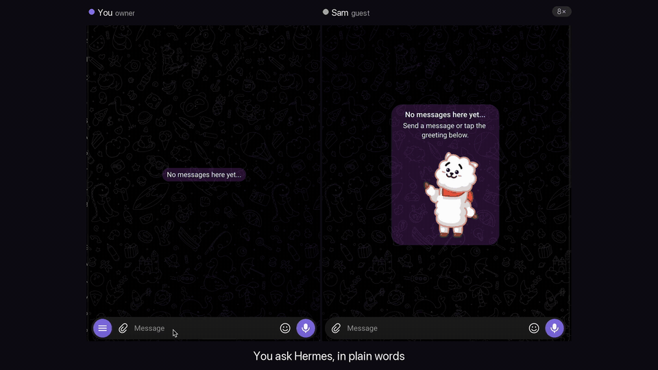

# Hermes Guests

[](https://github.com/tenuo-ai/hermes-guests/actions/workflows/checks.yml)

**Multi-user access for Hermes Agent.** Share your Hermes with family, friends and teammates without handing over your whole assistant. Each person chats with your Telegram bot from their own account, gets their own conversations and memory, and can use only what you approve, for as long as you choose.



> **You:** “Sam is visiting this weekend. Give Sam the front door, the thermostat and the guest room light until Sunday at 5.”
>
> Hermes shows you exactly what Sam will get. Approve, send Sam the invitation, and confirm Sam's account when they join.
>
> **Sam:** “Unlock the front door.” Done.<br>
> **Sam:** “Turn on the living room lights.” That isn't part of Sam's access, so Hermes offers to ask you. You approve, and the lights come on.

For a chat-only invitation, try “Let Alex chat for a day with no tools.”

**Why not just tell the bot who may do what?** Rules in a prompt can be talked around. Each guest's access is a signed, expiring [Tenuo](https://github.com/tenuo-ai/tenuo) warrant that only you can approve. The model can't sign or widen one, and Hermes Guests checks it in code before every guest turn and tool call. ([Trust model](docs/authorization.md#trust-model-built-for-ease-of-use))

## What you can do

- **Let your partner use your assistant without seeing your chats.** Each guest gets a separate Hermes profile with its own conversations and memory. Your own history, memory, skills and files stay out of reach; guests see only what the tools you share return.
- **Give a friend one thing, for a while.** The guest room light until Sunday, or your research tools for two days. Timed access ends on its own unless you extend it.
- **Let a teammate look without changing anything.** Share only a tool's read actions, such as checking status or searching, when the tool keeps reading and changing separate.
- **Invite someone just to chat**, with no tools at all.
- **Stay in charge from your own chat.** See who has access and what they did, approve their requests for more, and end access at any time.

It runs inside the Hermes you already have: no second install and no extra bot.

**Preview:** one owner, Telegram private text chats, Hermes 0.22.6 or later. Group chats and other messaging apps aren't supported yet.

## Get started

You'll need [Hermes](https://github.com/NousResearch/hermes-agent) with a working model and a Telegram bot. Set up the bot so your Telegram account is its only allowed user. Hermes Guests handles guest invitations.

**1. Install Hermes Guests** in the environment that runs your gateway. It's in the [Hermes plugin catalog](https://hermes-agent.nousresearch.com/docs/plugins/hermes-guests), so you can also install it from the plugin catalog in Hermes Desktop.

```sh
hermes plugins install hermes-guests --enable --yes-deps
```

Review any source-scan findings. Follow Hermes's reload prompt, or restart the gateway if your deployment manages it separately. [Installation help](docs/setup-recovery.md#installation-help)

**2. Set up sharing when you're ready.** Send a message in your private Telegram chat. Hermes replies as usual and offers **Set up guest sharing** once. You can ignore it and keep using Hermes. When you're ready, ask Hermes to share something or send `/guests_setup`. Review the setup and choose **Enable sharing**.

**3. Say what you'd like to share.** Use tools you've already connected to Hermes.

> “Let Alex use my research tools for two days. Give them a day to accept.”

Check the permission review, then choose **Approve**, **Change** or **Cancel**. Send the invitation to Alex and confirm the account that claims it. Alex can then chat with the bot using the access you approved.

## Keep it conversational

You can manage sharing from your own chat.

| What you want | Try saying |
| --- | --- |
| See current access | “Who has access?” |
| Change permissions | “Let Alex add to the shopping list too.” |
| Give more time | “Extend Alex's access until Sunday.” |
| End access | “End Alex's access.” |
| Check activity | “What did Alex do today? Show the times in my timezone.” |
| Delete a guest's data | “End Alex's access and delete their data.” |
| Never share something | “Never let guests unlock the front door.” |
| Keep guest data for a set time | “Delete guest data a week after access ends.” |

Permission changes, never-share changes and deletion require your confirmation. Guests can inspect their permissions and request more access or time from their own chat.

Each guest has separate conversations and private memory. Ending access stops further model use and tool calls, while keeping their data for a possible return. Data is kept until you delete it by default; you can choose automatic deletion in `/guests_setup`, and each new guest's review says which applies.

Prefer buttons? `/guests` shows who has access, with **Add a guest**, **Check sharing** and **Activity**. Open a guest to change what they can use, **Extend** their access, see their activity or end it. **Add a guest** asks in words, or lets you pick from a list. See the [command reference](docs/commands.md).

## How access works

1. **You ask** in your own chat. The model drafts the access from the tools you actually have enabled.
2. **You review.** Trusted plugin code turns the draft into a review card. Nothing is granted until you press **Approve**.
3. **Hermes Guests signs a warrant** for that guest on this machine: which tools, with what limits, until when.
4. **Every guest turn is checked.** Each turn runs as a separate Hermes agent process in the guest's own profile. Its tool calls go through a server on `127.0.0.1` that checks the warrant before anything runs.

Every guest needs a valid signed warrant to chat or call a tool. The warrant limits what they can do and when access ends. Even chat-only access requires a warrant. Hermes Guests issues an owner warrant too. Your ordinary Hermes tools keep working if that warrant is missing or invalid. You can opt into requiring an owner warrant in [advanced setup](docs/setup-recovery.md#owner-warrants). [Authorization details](docs/authorization.md)

Guest profiles and processes are separate, but they are not an OS sandbox: share only tools whose effects you would accept from that guest. Guests use your model quota. Their messages go to Telegram and your configured model. Approved tool calls send their inputs to the service you shared. Hermes stores guest conversations, memory, and access records locally in separate profiles.

[Model setup](docs/setup-recovery.md#model-setup) · [Security and limits](docs/advanced.md)

## What it does on your machine

- **Background work.** While the gateway runs, a maintenance task checks access every minute: it renews the owner and no-end-date warrants, sends the notices before and when access ends, and applies data retention.
- **Separate guest processes.** Each guest turn runs a native Hermes agent in its own process, in a separate Hermes profile created for that guest. Its tool calls go through a server on `127.0.0.1` that checks the guest's warrant before anything runs.
- **Your configuration.** When you press **Enable sharing**, Hermes Guests adds itself to your Telegram tools if you chose them explicitly. Guest profiles are created and, when you delete a guest's data, removed.
- **Keys and records.** Signing keys, warrants, access records, receipts and activity are stored in the plugin's own data folder. Signing happens on this machine; see the [trust model](docs/authorization.md#trust-model-built-for-ease-of-use).
- **Network.** Hermes Guests makes no network calls of its own beyond your model provider, through Hermes, and Telegram. Shared tools reach whatever services they already use. Nothing is reported anywhere.
- **Credentials.** Model keys come from your Hermes profile, and a Codex sign-in is used through Hermes without the plugin holding the token.

## Removing Hermes Guests

`hermes plugins remove hermes-guests` stops the plugin, but it leaves guest data and keys in place in case you reinstall. To remove everything:

1. **End each guest's access and delete their data first.** In Telegram, send `/guests`, open each guest, and press **End and delete data**. This removes their `guests-*` Hermes profile, their conversations and their memories. Do this before removing the plugin, because nothing else will clean those profiles up afterwards.
2. **Remove the plugin:** `hermes plugins remove hermes-guests`, then restart the gateway.
3. **Delete its data folder:** `plugin-data/agent-plugin-hermes-guests-*` inside your Hermes profile. It holds the signing keys, warrants, access records and activity. Keep a copy if you want the activity history.
4. **Free the dependencies:** `hermes pm gc` removes packages nothing uses any more. Don't delete files under `installs/` by hand; if something looks wrong there, run `hermes pm repair`.

If a `guests-*` profile is still listed by `hermes profile list` after step 1, remove it with `hermes profile delete <name>`.

## Contribute

Try the [sharing scenarios](docs/scenarios.md), [report an issue](https://github.com/tenuo-ai/hermes-guests/issues), or read [CONTRIBUTING.md](CONTRIBUTING.md) to work on the code.

Licensed under [Apache-2.0](LICENSE).
